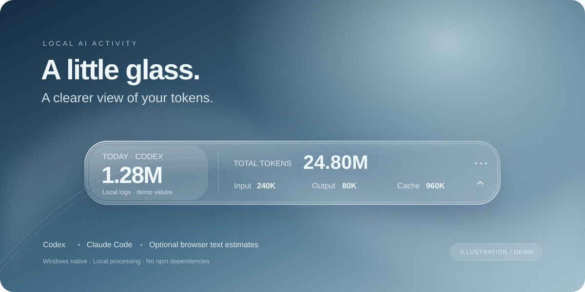

# Token Glass

**A little glass window into your AI token activity.**

A native Windows widget for Codex and Claude Code, with optional ChatGPT / Claude browser text estimates.

[简体中文](README.md) · [Usage guide](docs/usage.md) · [Contributing](CONTRIBUTING.md)



Token Glass shows today's input, output, cache and lifetime token totals in a movable, foldable glass-style widget. A local dashboard adds date filters, trends, model / project breakdowns, recent records and CSV export. The UI uses WPF and Windows Composition; the service uses Node.js built-ins with no npm dependencies.

## Supported sources

| Source | Collection | Measurement |
| --- | --- | --- |
| Codex CLI / compatible desktop logs | Local JSONL | Usage fields reported in logs |
| Claude Code, including subagents | Local JSONL | Usage fields reported in logs |
| ChatGPT web | Optional Chrome extension | Visible text estimates, experimental |
| Claude web | Optional Chrome extension | Visible text estimates, experimental |

**Browser text estimates are not official usage, billing or subscription limits.** They exclude context replay, hidden reasoning, images, attachments, cache, tools and unloaded history. Estimates are marked with `≈`. Browser adapters have local fixture / protocol coverage but have not yet been verified end to end against live account pages; site DOM changes may require selector updates.

## Quick start

A Windows x64 portable package is available in [Releases](https://github.com/Whitersir/token-glass/releases/latest). It includes the compiled widget; Node.js 20+ is still required. Run `setup.cmd` to create private local configuration. To build from source:

Requirements: Windows x64, Node.js 20+, .NET Framework 4.8 and Windows WinRT metadata. Primarily tested on Windows 11; the Windows 10 2004+ path has not been verified on a physical machine. Visual Studio is not required.

```powershell
git clone https://github.com/Whitersir/token-glass.git
cd token-glass
powershell -NoProfile -ExecutionPolicy Bypass -File setup.ps1
```

Alternatively, download the repository ZIP, extract it to a permanent folder and double-click `setup.cmd`. Setup preserves existing configuration, creates private local configuration when missing, builds the widget, prepares the local browser connection and launches the tray companion. No `npm install` is needed.

- `start.cmd`: launch again.
- `enable-autostart.cmd`: opt into Windows login startup.
- `disable-autostart.cmd`: remove login startup and quit.
- `stop.cmd`: fully quit this run.
- Widget menu → open details: local dashboard, normally `http://127.0.0.1:7681`.

The widget automatically follows Codex windows. With the extension connected, it can follow visible chat pages. Select Claude Code or another fixed source from the source menu. Closing the bar leaves the companion waiting; fully quitting stops automatic following.

## Optional Chrome extension

After setup, open `chrome://extensions`, enable Developer mode and load the repository's `browser-extension` folder with **Load unpacked**. Refresh ChatGPT or Claude chat pages and check the extension popup. Connection credentials are generated locally; do not share `connection.js`.

Conversation input/output high-water marks prevent duplicate counting after refreshes, streaming updates and duplicate tabs. Previously written messages are attributed to the date this installation first receives their counts. Branch changes, regenerations, virtualized history and offline periods cannot be reconstructed as complete request-level usage.

## Configuration and privacy

[`config.example.json`](config.example.json) contains public defaults with **zero** historical offsets. Setup copies it to ignored, private `config.json`. Configure log roots, timezone, refresh interval, historical offsets or disable browser ingress there.

```powershell
node src/cli.js sync
node src/cli.js report --json
node src/cli.js serve --open
node src/cli.js export usage.csv
node src/prepare-browser-extension.js
```

Changing the port requires regenerating the browser connection and reloading the extension. See the [full guide](docs/usage.md) for counting rules.

Logs are read without modification. Chat text is processed in memory but not stored in the statistics database. The extension sends counters, hashed identifiers and page-presence metadata to loopback only; it does not read cookies or login credentials. Browser ingress requires a per-installation key.

Usage files and CSVs still contain metadata such as timestamps, models, session identifiers and local paths. Keep them private. Personal configuration, statistics, backups, keys and build output are excluded from source publication. See [SECURITY.md](SECURITY.md).

## Development

```powershell
node --test
powershell -NoProfile -ExecutionPolicy Bypass -File build-widget.ps1 -Test
```

CI checks service tests, native compilation and lifecycle behavior. GPU initialization is skipped on headless runners; appearance needs an interactive Windows desktop. Rendering uses live Gaussian blur and surface highlights, not an optical refraction shader. This independent project is not affiliated with OpenAI or Anthropic.

Read [CONTRIBUTING.md](CONTRIBUTING.md) before opening a PR. MIT licensed; see [LICENSE](LICENSE). Rendering and README inspirations are listed in the [Chinese README](README.md#致谢与许可).
