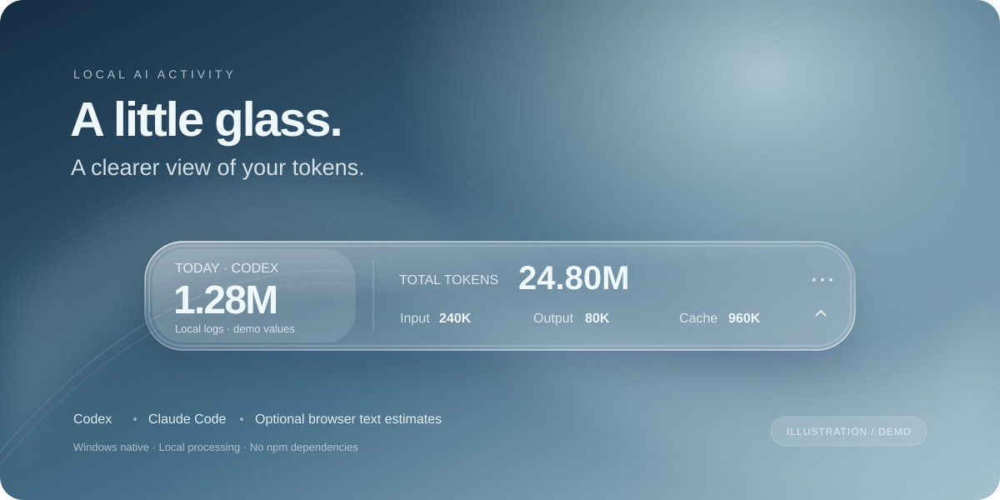
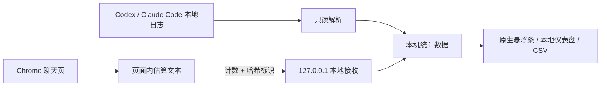

<div align="center">

# Token Glass

**把 AI 用量，放在桌面的一小片玻璃里。**

Windows 原生悬浮条 · Codex / Claude Code 日志统计 · ChatGPT / Claude 网页文本估算

[](#运行要求)
[](#快速开始)
[](https://github.com/Whitersir/token-glass/actions/workflows/ci.yml)
[](LICENSE)

[快速开始](#快速开始) · [支持范围](#支持范围) · [网页扩展](#连接网页聊天) · [使用文档](docs/usage.md) · [English](README.en.md)



<sub>界面示意，数字为演示数据。实际模糊与透明效果随桌面背景、Windows 版本和显示缩放变化。</sub>

</div>

Token Glass 是一个在本机运行的 AI token 统计工具：用圆角玻璃悬浮条查看今日输入、输出、缓存与累计用量，需要细看时再打开本地仪表盘。原生界面使用 WPF / Windows Composition，统计服务使用 Node.js 内置模块，无需安装 npm 依赖。

> **两种口径，分别标注。** Codex / Claude Code 从日志读取用量字段；ChatGPT / Claude 网页只能估算已加载的可见文本，使用 `≈` 标记。网页估算不等于官方 token 消耗、订阅额度或账单。

## 为什么用 Token Glass

- **一眼看到今日用量**：输入、输出、缓存和累计总量集中展示。
- **融入桌面的玻璃外观**：实时 GPU 背景模糊、平滑圆角、边缘高光、鼠标反光与柔和阴影。
- **跟随你的工作**：检测 Codex 窗口；连接 Chrome 扩展后可跟随聊天网页，也可手动固定来源。
- **需要时再展开**：拖动、折叠、置顶、托盘待命，以及可选的 Windows 登录自启动。
- **细节留在本地仪表盘**：日期与来源筛选、趋势、模型 / 项目分布、最近记录和 CSV 导出。
- **本地处理**：不需要提供账号密码或 API key，不上传聊天正文，不引入分析追踪服务。

## 支持范围

| 来源 | 采集方式 | 统计口径 | 状态 |
| --- | --- | --- | --- |
| Codex CLI / 兼容日志的桌面端 | 本地 `.jsonl` 日志 | 日志报告的 token 用量 | 已实现 |
| Claude Code | 本地 `.jsonl` 日志，含子代理 | 日志报告的 token 用量 | 已实现 |
| ChatGPT 网页 | 可选 Chrome 扩展 | 已加载可见文本的估算 | 实验性，需加载扩展 |
| Claude 网页 | 可选 Chrome 扩展 | 已加载可见文本的估算 | 实验性，需加载扩展 |

网页适配器已通过本地模拟与接收接口测试；尚未完成真实账号网页的端到端验证。网站 DOM 改版可能需要更新采集选择器。当前自动跟随的原生应用是 Codex，Claude Code 统计可在来源菜单中选择。

## 快速开始

### 运行要求

- Windows x64。主要在 Windows 11 验证；Windows 10 2004+ 的兼容路径尚未完成实机验证。
- Node.js **20+**，可从 [Node.js 官网](https://nodejs.org/)安装。
- Windows 自带的 .NET Framework 4.8 与 WinRT 元数据。无需安装完整 Visual Studio。

### 从源码启动

也可以从 [Releases](https://github.com/Whitersir/token-glass/releases/latest) 下载 Windows x64 便携包。包内含已编译的悬浮条；仍需安装 Node.js 20+，然后双击 `setup.cmd` 生成本机配置。源码安装方式如下：

```powershell
git clone https://github.com/Whitersir/token-glass.git
cd token-glass
powershell -NoProfile -ExecutionPolicy Bypass -File setup.ps1
```

也可下载仓库 ZIP，解压到固定目录后双击 **`setup.cmd`**。脚本会保留已有配置，首次创建 `config.json`、编译悬浮条、生成本机网页连接配置并启动。整个过程无需 `npm install`。

检测到 Codex 后悬浮条自动显示。右键或点击 `⋯` 可同步、查看详情、切换来源和关闭显示。

| 你想做的事 | 操作 |
| --- | --- |
| 再次启动 | 双击 `start.cmd` |
| Windows 登录后自动待命 | 双击 `enable-autostart.cmd` |
| 取消登录自启动 | 双击 `disable-autostart.cmd` |
| 完全退出本次运行 | 双击 `stop.cmd`，或托盘 → 完全退出后台 |
| 查看详细统计 | 悬浮条菜单 → 打开详细统计，默认 `http://127.0.0.1:7681` |

“关闭悬浮条”会保留后台待命，下次打开应用可恢复；“完全退出后台”会停止跟随，需要手动启动或等待下次登录自启动。

## 连接网页聊天

运行过 `setup.cmd` 后：

1. 在 Chrome 地址栏打开 `chrome://extensions`，启用“开发者模式”。
2. 点击“加载已解压的扩展程序”，选择仓库内的 **`browser-extension`** 文件夹。
3. 刷新 ChatGPT / Claude 聊天网页；点击扩展图标检查连接状态。
4. 在悬浮条“统计来源”中选择自动跟随、对应网页或全部来源。

本机连接密钥自动生成，无需手工填写。改变端口后重新运行 `node src/prepare-browser-extension.js`，并在 Chrome 中重新加载扩展。

**网页数据的边界：** 只统计页面已经加载的可见消息；不包含图片、附件、隐藏推理、上下文重复发送、缓存或工具调用。首次打开的历史消息归入本机首次接收计数的日期。通过会话计数最大值避免刷新、流式更新和重复标签页重复累计；无法还原分支、重新生成或跨天离线期间的完整调用历史。详见[使用文档](docs/usage.md)。

## 配置与命令

公开默认值位于 [`config.example.json`](config.example.json)，首次启动会复制为本机私有的 `config.json`。历史补录默认为 **0**，不会带入开发者的用量。

```powershell
node src/cli.js sync                 # 增量扫描日志
node src/cli.js report               # 查看本地汇总
node src/cli.js report --json        # JSON 输出
node src/cli.js serve --open         # 本地仪表盘
node src/cli.js export usage.csv     # 导出 CSV，不覆盖同名文件
node src/prepare-browser-extension.js # 生成 / 更新本机网页连接配置
```

日志位置可通过 `roots` 指定；支持 `CODEX_HOME` 和 `CLAUDE_CONFIG_DIR`。完整配置、统计公式与去重边界见[使用文档](docs/usage.md)。运行仪表盘时，使用页面内的“立即同步”。

## 隐私设计



- 聊天正文仅在解析时进入内存，不写入统计数据库；扩展不读取 Cookie 或登录凭据。
- 服务只监听 `127.0.0.1`；网页接收使用每台安装随机生成的连接密钥。
- 统计文件仍含时间、模型、会话 ID、项目 / 日志路径等元数据；CSV 也可能含路径与标识，分享前请脱敏。
- `data/`、`backup/`、个人 `config.json`、`node-path.txt`、扩展 `connection.js` 和编译产物均排除在源码发布之外。

详见 [SECURITY.md](SECURITY.md)。项目没有云同步或应用内遥测；README 的 GitHub 徽章由外部图片服务提供。

## 常见问题

**这是官方插件吗？** 这是独立的 Windows 伴随工具，不隶属于 OpenAI 或 Anthropic，也不修改它们的安装文件。

**能显示订阅剩余额度或费用吗？** 目前不支持。日志 token 和网页文本估算都不能直接换算订阅额度。

**是完整的液态玻璃折射吗？** 当前使用实时高斯模糊与表面高光，不包含光学折射着色器。合成器不可用时会尝试回退到系统模糊。

**网页没有统计怎么办？** 确认桌面工具正在运行、已生成 `connection.js`、扩展已加载且网页已刷新。检查扩展弹窗和本地安装说明页。无法识别消息时，可用脱敏信息提交 Issue。

## 开发与贡献

```powershell
node --test
powershell -NoProfile -ExecutionPolicy Bypass -File build-widget.ps1 -Test
```

CI 验证 JavaScript 测试、Windows 编译与关闭 / 重开逻辑；无桌面环境下跳过 GPU 初始化检查。真实玻璃效果仍需在交互式 Windows 桌面验证。

欢迎提交问题反馈、文档改进和小范围 PR。请先阅读 [CONTRIBUTING.md](CONTRIBUTING.md)，测试样例与截图使用演示数据。

## 致谢与许可

效果与架构研究参考了 [WPF Liquid Glass](https://github.com/dragosniamtu/WPF-Liquid-Glass-Effect)、[Island Command Center](https://github.com/primez-x/windhawk-island-command-center) 以及 Microsoft 的 Windows Composition / Direct2D 文档；未引入这些项目的运行库。介绍页组织参考了 [ccusage](https://github.com/ccusage/ccusage) 与 [PowerToys](https://github.com/microsoft/PowerToys)。

代码采用 [MIT License](LICENSE)。

